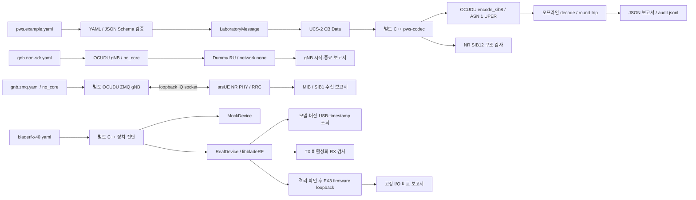

# 아키텍처

기본 offline/진단 모듈과 선택적 PWS 연동을 분리한다. offline encoder는 장치를 열지 않고, standalone 진단은 고정 I/Q 패턴만 생성한다. 새 PWS 연동 controller가 검증한 메시지로 gNB CMAS test 설정을 생성한다. [확장 diagram](PWS_INTEGRATION.md)을 참조한다.

기본 offline 명령은 scheduler에 연결하지 않는다. 별도 `controller.pws_integration`은 기존 OCUDU static CMAS 설정으로 SI scheduler에 연결하며 ZMQ 수신을 검증한다. live NGAP warning 입력은 추가하지 않았다. Python controller에도 warning distribution server나 IQ export interface가 없다. CMAS 처리는 실제 NR SIB8 구조이며 NR SIB12는 별도 sidelink 구조 검사다.

## 구현 단위

| 단위 | 구현 |
|---|---|
| 설정 로더/validator | `controller/config_loader.py`, 두 JSON Schema |
| 불변 메시지 모델 | `controller/message_model.py`의 frozen dataclass |
| 문자/CB Data | `controller/cb_data.py` |
| codec process boundary | `controller/protocol.py`의 `OfflineCodec` |
| OCUDU 통합 | `controller/offline_codec/`, upstream build plugin symlink |
| 보고/audit | `controller/reporting.py`, `controller/checkpoints.py` |
| gNB lifecycle | `controller/gnb.py` |
| hardware orchestration | `controller/hardware.py` |
| C++ 장치 abstraction | `driver_adapter/device.h`의 `Device`, `Direction`, `RxBlock`, `Failure` |
| 장치 구현 | `real_device.cpp`, `mock_device.cpp` |
| 제한된 streaming | `loopback_tests/runner.cpp`, RAII stop guard |

C++ codec는 stdin의 제한된 JSON만 받고 stdout으로 결과를 반환한다. OCUDU에서 가져오는 source는 원본 `pws_sib_encoder.cpp`이고 `rrc_nr_asn1`에 링크한다. gNB 실행 파일에는 이 codec target을 링크하지 않는다.

`Device` interface는 message model을 include하지 않는다. standalone 진단은 libbladeRF 없는 mock build도 가능하다. 고장/미연결 장치가 공유 Python 모듈이나 codec의 정상 동작에 영향을 주지 않는다.

ZMQ 확장은 별도의 Non-SDR backend로 `controller/zmq_rx.py`가 실제 gNB와 srsUE를 함께 실행한다. 이 기존 명령은 공유 PWS를 전달하지 않는다. 별도 `controller.pws_integration`과 SI monitor patch가 실제 SIB8 수신·재조립을 담당하며, `PWS_LAB_SI_MONITOR`가 없는 기본 srsUE RRC 경로도 회귀 검사한다.

## 상태와 오류

모든 보고서에 mode, version, OCUDU commit, host, timestamp, artifact 위치, 테스트 이름/결과, error를 넣는다. 장치 정보는 가능한 경우만 채우고 미확인 값은 null로 둔다. mock은 `mock=true`, `hardware_verified=false`를 유지한다. UPER/CB Data 결과는 결정적이며 실행 시간/host가 포함된 전체 보고서는 실행별로 달라진다.

`StopGuard`는 streaming 성공과 예외에서 RX/TX 비활성화를 시도한다. loopback 후 normal RF mode로 자동 복원하지 않는다. 프로세스 강제 종료나 USB disconnect에서는 cleanup 완료를 보장하지 않으므로 하드웨어 검증 완료로 처리하지 않는다.

## OCUDU radio 통합 평가

`hardware/bladerf-x40/radio_plugin`은 `radio_factory`/`radio_session`을 구현하며 upstream 수정 없이 동적 로딩된다. 고정 OCUDU gateway는 ci16_t이며 SC16_Q11 변환, timestamp 전달, continuity, event, stop/watchdog를 구현했다. 실제 gNB mock stream 및 실제 library를 링크한 API double 검사는 PASS다. USB jitter, 실제 RX/TX timestamp domain, 시작 정렬 및 RF 성능은 NOT VERIFIED다. [plugin 상세](RADIO_PLUGIN.md)를 참조한다.

## LTE SIB12 경로

`controller/lte_sib12.py`는 공유 schema와 `LaboratoryMessage`, `cb_data`를 사용하고 srsENB의 LTE SIB12 encoder/scheduler를 호출한다. ZMQ IQ를 받은 srsUE가 실제 LTE ASN.1을 unpack한 뒤 metadata/payload를 기록한다. LTE segment 재조립은 NR SIB8의 규칙과 별도다. `controller/pws_profiles.py`의 실험용 ID/PLMN만 두 경로가 공유한다. [LTE 구성도](LTE_SIB12.md)를 참조한다. LTE build는 OCUDU와 bladeRF에 의존하지 않는다.
