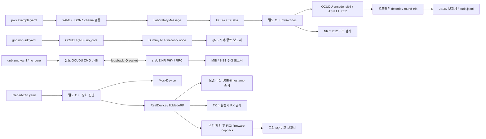

# 아키텍처

세 실행 경계를 분리한다. PWS encoder는 장치를 열지 않고, gNB는 laboratory PWS 파일을 읽지 않으며, bladeRF 진단은 고정 I/Q 패턴만 생성한다.

PWS에서 gNB SI scheduler, NGAP warning, F1AP warning, radio driver로 이어지는 연결은 없다. Python controller에도 warning distribution server나 IQ export interface가 없다. CMAS 처리는 실제 NR SIB8 구조이며 NR SIB12는 별도 sidelink 구조 검사다.

## 구현 단위

| 단위 | 구현 |
|---|---|
| 설정 로더/validator | `controller/config_loader.py`, 두 JSON Schema |
| 불변 메시지 모델 | `controller/message_model.py`의 frozen dataclass |
| 문자/CB Data | `controller/cb_data.py` |
| codec process boundary | `controller/protocol.py`의 `OfflineCodec` |
| OCUDU 통합 | `controller/offline_codec/`, upstream build plugin symlink |
| 보고/audit | `controller/reporting.py`, `controller/checkpoints.py` |
| gNB lifecycle | `controller/gnb.py` |
| hardware orchestration | `controller/hardware.py` |
| C++ 장치 abstraction | `driver_adapter/device.h`의 `Device`, `Direction`, `RxBlock`, `Failure` |
| 장치 구현 | `real_device.cpp`, `mock_device.cpp` |
| 제한된 streaming | `loopback_tests/runner.cpp`, RAII stop guard |

C++ codec는 stdin의 제한된 JSON만 받고 stdout으로 결과를 반환한다. OCUDU에서 가져오는 source는 원본 `pws_sib_encoder.cpp`이고 `rrc_nr_asn1`에 링크한다. gNB 실행 파일에는 이 codec target을 링크하지 않는다.

`Device` interface는 message model을 include하지 않는다. standalone 진단은 libbladeRF 없는 mock build도 가능하다. 고장/미연결 장치가 공유 Python 모듈이나 codec의 정상 동작에 영향을 주지 않는다.

ZMQ 확장은 별도의 Non-SDR backend로 `controller/zmq_rx.py`가 실제 gNB와 srsUE를 함께 실행한다. 공유 PWS message는 이 링크로 전달하지 않는다. srsUE NR 경로는 SIB1 수신만 처리하며, 이 프로젝트의 offline SIB8 engine과 연결되지 않는다.

## 상태와 오류

모든 보고서에 mode, version, OCUDU commit, host, timestamp, artifact 위치, 테스트 이름/결과, error를 넣는다. 장치 정보는 가능한 경우만 채우고 미확인 값은 null로 둔다. mock은 `mock=true`, `hardware_verified=false`를 유지한다. UPER/CB Data 결과는 결정적이며 실행 시간/host가 포함된 전체 보고서는 실행별로 달라진다.

`StopGuard`는 streaming 성공과 예외에서 RX/TX 비활성화를 시도한다. loopback 후 normal RF mode로 자동 복원하지 않는다. 프로세스 강제 종료나 USB disconnect에서는 cleanup 완료를 보장하지 않으므로 하드웨어 검증 완료로 처리하지 않는다.

## OCUDU radio 통합 평가

유지보수 가능한 향후 확장 지점은 `radio_factory` plugin과 `radio_session`이다. 그러나 CF32 계열 baseband buffer와 SC16_Q11 변환, timestamp domain, timed TX, RX continuity, 시작 시각 동기화, stream stop, overflow event mapping, USB jitter budget을 검증해야 한다. 이 repository는 해당 plugin을 제공하지 않는다. standalone 진단을 OCUDU PHY 호환성 검증으로 간주하지 않는다. SoapySDR 지원도 가정하지 않는다.
