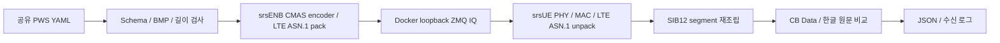

# LTE SIB12 ZMQ 수신 시험

LTE CMAS는 `SystemInformationBlockType12-r9`로 전달한다. NR CMAS의 SIB8 경로와 별도다. 이 기능은 **srsRAN 4G의 srsENB와 패치된 srsUE**를 사용하며 OCUDU gNB를 LTE로 바꾸지 않는다. 공유 PWS YAML, UCS-2 CB Data 검증, 보고 형식은 재사용한다.



## 구현 근거와 범위

고정 srsRAN 4G `release_25_10`, commit `6bcbd9e5bf8686aa7085202cd847c5ddd64a9c16`을 사용한다. 원본에서 확인한 파일은 다음과 같다.

| 기능 | upstream 경로 | 처리 |
|---|---|---|
| SIB12 구조 | `lib/include/srsran/asn1/rrc/bcch_msg.h`, `sib_type12_r9_s` | 원본 ASN.1 pack/unpack 재사용 |
| PWS 설정 | `srsenb/src/enb_cfg_parser.cc`, `parse_sib12()` | 원본 parser 재사용, vector 재할당 후 무효 참조 수정 |
| UCS-2 CB Data | `srsenb/src/cbs_encoding/cbs_encoder.cpp`, `fill_cb_data_ucs2()` | UTF-8 → UCS-2 BE, page 82 bytes, 최대 15 pages |
| SIB 스케줄링 | `srsenb/src/stack/rrc/rrc.cc`, SIB12 segment packing | 원본 RRC/MAC 송신 경로 재사용 |
| LTE 수신 | `srsue/src/stack/rrc/rrc.cc`, `parse_pdu_bcch_dlsch()` | SIB1 PLMN 및 SIB12 metadata/payload 로그 추가 |
| SI 유지 | `srsue/src/stack/mac/mac.cc`, `get_dl_sched_rnti()` | 시험 모드에서 SI-RNTI 검색 유지 |
| attach 억제 | `srsue/src/stack/rrc/rrc_procedures.cc`, `cell_search_proc::step_si_acquire()` | 시험 모드에서 cell search 후 SI 수신 유지 |

`PWS_LAB_LTE_SI_MONITOR=1`일 때만 LTE monitor가 활성화된다. 기본 UE 동작과 NR monitor 환경변수는 별개다. 일반 휴대전화의 상용 CBS client, warning paging, 팝업·소리·재난문자 등급 처리는 구현하지 않는다. SIB12는 주기적으로 수신하며 paging 기반 새 경고 발견 절차를 검증하는 시험이 아니다.

근거: [공식 ZMQ virtual radio 설명](https://docs.srsran.com/projects/4g/en/latest/app_notes/source/zeromq/source/index.html), [고정 srsENB parser](https://github.com/srsran/srsRAN_4G/blob/6bcbd9e5bf8686aa7085202cd847c5ddd64a9c16/srsenb/src/enb_cfg_parser.cc), [고정 LTE ASN.1 정의](https://github.com/srsran/srsRAN_4G/blob/6bcbd9e5bf8686aa7085202cd847c5ddd64a9c16/lib/include/srsran/asn1/rrc/bcch_msg.h).

## 빌드와 실행

macOS에서는 Docker/Colima Linux 환경을 사용한다. Linux native build에는 Ubuntu 24.04, Clang 18, CMake/Ninja, Boost program_options, FFTW, mbedTLS, SCTP, ZeroMQ, libconfig++가 필요하다. 기존 고정 toolchain에 `libconfig++-dev`를 추가한다. Ubuntu package snapshot은 `20261001T000000Z`이며 libconfig++ `1.5-0.4build2`, libsctp `1.0.19+dfsg-2build1`, libzmq `4.3.5-1build2`를 사용한다.

```bash
bash scripts/build-lte-docker.sh
docker compose -f docker/compose.lte.yaml --profile lte-zmq up \
  --abort-on-container-exit --exit-code-from lte-sib12
```

`build-lte.sh`는 OCUDU 또는 bladeRF 빌드 없이 독립적으로 `build/bin/srsenb-lte`, `build/bin/srsue-lte`를 만든다. 빌드 CMake 설정에서 UHD, bladeRF, SoapySDR, RF plugins를 끈다. 실행기는 ZMQ loopback 주소만 생성하고 `--network none`을 확인한다. USB/TUN mapping, privileged, EPC, 인터넷 연결은 실행에 필요하지 않다.

한글 입력은 `configs/pws.example.yaml`의 `pws.message.text`를 수정한다. 최대 615 BMP 문자이며 `[시험` 또는 `[TEST]`로 시작해야 한다. 기본값은 국내 PLMN `45005`, profile `korean-safety`다.

```bash
# 독립 runtime: 결과를 Docker volume에 보존한다.
docker run --rm --network none --cap-drop ALL --memory 3g --cpus 4 \
  -v lte-sib12-output:/lab/output pws-lab-lte:0.1.0 \
  receive --plmn 45008 --profile korean-safety --output /lab/output/kt

# build 환경에서 전체 시험. Python dependencies를 처음 한 번 준비한다.
docker run --rm -v "$PWD:/lab" pws-lab-lte-toolchain:0.1.0 bash -c \
  'python3 -m venv build/venv && build/venv/bin/pip install -r requirements-dev.txt'
docker run --rm --network none --cap-drop ALL --memory 3g --cpus 4 \
  -v "$PWD:/lab" -e LAB_PYTHON=build/venv/bin/python \
  pws-lab-lte-toolchain:0.1.0 bash scripts/test-lte-sib12.sh
```

## 설정과 결과

| 선택값 | 기본값 / 허용값 | 의미 |
|---|---|---|
| `--config` | `configs/pws.example.yaml` | 공유 schema v1, UTF-8 YAML |
| `--profile` | `korean-safety` / `monthly-test` | messageIdentifier 4372 / 4380 |
| `--plmn` | `45005` / `45008` / `45006` / `00101` | SIB1 MCC/MNC 및 시험 USIM prefix |
| `--timeout` | 60, 허용 5..120초 | 전체 segment 수신 상한 |
| `--output` | `output/lte-sib12` | 생성 설정, 원본 로그, JSON, audit |
| `--enb`, `--ue` | `build/bin/srsenb-lte`, `build/bin/srsue-lte` | 독립 build 산출물 |
| `prepare` | 수신 실행 안 함 | schema 검사 및 설정 생성; 수신 `NOT VERIFIED` |
| `receive` | 실제 ZMQ 시험 | 수신 payload·원문·PLMN 및 정상 종료 검증 |

`serial_num=0`, DCS `0x48`을 사용한다. 4372는 이 프로젝트의 국내 안전안내 시험 profile 매핑이며, 실제 국내 단말의 경고 분류·표시를 보장하지 않는다. `[시험]` prefix, profile 및 PLMN은 수신기와 일치해야 한다.

고정 upstream의 CB Data는 zero padding을 사용한다. 공유 Python codec의 `padding="ocudu-zero"` profile을 srsENB 비교에도 사용한다. LTE SIB12는 CB Data를 **최대 100-byte segment**로 나누며 마지막 segment에 추가 padding을 붙이지 않는다. 최초 segment에만 DCS를 넣는다. 615자 CB Data는 1,246 bytes, LTE SIB12 13 segments다. NR SIB8의 84/85-byte segment 규칙과 섞지 않는다.

생성 `enb.conf`, `ue.conf`는 INI이고 `sib.conf`, `rr.conf`, `rb.conf`는 libconfig다. `configs/lte/`는 고정 upstream example에서 가져온 AGPL template이며 SHA-256을 검사한다. SIB1 SI window는 20 ms, SIB2/3 period는 16 radio frames, SIB12 period는 8 radio frames다. LTE FDD 25 PRB, EARFCN 3350, ZMQ base sample rate 23.04 Msps를 사용한다. 이 값들은 가상 IQ sample의 PHY 설정이다.

출력에는 `srsenb.log`, `srsue.log`, `lte-sib12.json`, `audit.jsonl`이 있다. 보고서에 `rat=LTE`, `srsran4g_commit`, `ocudu_used=false`, 수신 PLMN, text, payload hex, segment 수, 두 process의 exit code를 저장한다. 공통 `ocudu_commit`은 workspace pin이고 LTE 실행 binary를 의미하지 않는다.

## 실행 상한과 체크포인트

| 단계 | 상한 / 통과 조건 |
|---|---|
| Docker 전체 빌드 | 2,700초, 기본 4 GiB / 2 CPUs, GitHub CI 8 GiB / 4 CPUs |
| C++ 빌드 | 1,800초, 기본 2 jobs, 최대 4 jobs |
| 수신 실행 | 기본 60초, 최대 120초; process별 log 32 MiB |
| 종료 | UE 먼저 SIGINT, 이어 eNB, 각각 10초 후 SIGKILL; 강제 종료는 FAIL |
| 전체 LTE 시험 | 420초; 한국어 3 PLMN, 영어, 615자 경계 |
| GitHub Actions | 60분; 실제 hardware 없이 image build 및 한글 ZMQ 수신 |

PASS는 실제 수신한 모든 segment, messageIdentifier, serial, DCS, CB Data, 한글 원문, SIB1 PLMN, 정상 종료가 일치한 경우다. 입력 오류는 exit 2, 비격리 network는 BLOCKED/3, 제한 시간은 FAIL/4, process 또는 round-trip 실패는 FAIL/1이다. 설정 생성 PASS와 수신 PASS는 보고서 test_name으로 구분한다.

## 문제 해결과 제한

- `Failed to connect to MME`: EPC를 실행하지 않는 SI-only 시험에서 예상되는 eNB 로그다. SIB12 수신과 두 process 정상 종료가 성공해야 PASS다.
- `E_EARLY_EXIT`: eNB/UE log 앞부분에서 libconfig 문법, missing shared library, ZMQ port 점유, SCTP socket 실패를 확인한다.
- `E_RX_TIMEOUT`: 셀 검색 및 SIB1 PLMN 로그부터 확인한다. CPU 제한, NR 전용 UE config 사용, 새 patch가 반영되지 않은 binary를 확인한다. 로그에 수신 segment가 일부 있어도 PASS가 아니다.
- `E_LTE_METADATA` 또는 `E_LTE_CONFLICT`: 새 srsENB segment metadata patch를 적용해 다시 빌드한다. 다른 identifier/serial을 섞은 수신을 성공 처리하지 않는다.
- 실제 bladeRF, 국내 휴대전화, 외부 RF, LTE warning paging·S1AP WRITE-REPLACE WARNING 경로는 이 시험의 검증 대상이 아니다. hardware 검증 결과는 `NOT VERIFIED`다.

정리: `docker compose -f docker/compose.lte.yaml --profile lte-zmq down`으로 container를 정리한다. `-v`는 저장된 시험 결과 volume도 삭제하므로 결과 보존 여부를 확인하고 사용한다. 원본 로그와 최종 시험 결과는 [검증 보고서](LTE_SIB12_VERIFICATION.md)를 참조한다.
