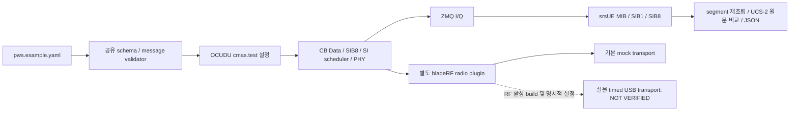

# PWS → OCUDU SI → srsUE 수신

기존 offline codec에 더해 `controller.pws_integration`이 검증한 laboratory text를 **실제 upstream CMAS test 설정**에 연결한다. OCUDU가 CB Data와 NR SIB8을 생성하고 SI scheduler와 PHY를 거쳐 ZMQ I/Q로 내보낸다. 수신기는 패치한 srsUE의 SI monitor다. 실제 RF 없이 Docker `--network none`으로 실행한다.



기존 `controller validate`, standalone 진단과 `controller.zmq_rx`는 각각 offline, 장치 진단, 일반 MIB/SIB1/RRC 회귀 시험 역할을 유지한다. 새 명령만 공유 메시지를 SI scheduler에 전달한다. NGAP live warning 서버나 외부 배포 API는 추가하지 않았다.

## 실행

```bash
bash scripts/build-pws-integration-docker.sh
docker compose -f docker/compose.pws.yaml --profile pws-zmq run --rm reception
```

또는 재빌드한 ZMQ 이미지:

```bash
docker run --rm --network none --cap-drop ALL --memory 3g --cpus 4 \
  --entrypoint python pws-lab-zmq:0.1.0 -m controller.pws_integration \
  receive --profile korean-safety --timeout 60
```

bind mount로 로그를 보관할 때는 이미지의 UID 10001이 쓸 수 있는 output 경로를 준비한다. Compose는 named volume에 `pws-integration.json`, `gnb.log`, `srsue.log`, `audit.jsonl`, 생성 YAML을 보관한다. native CLI는 `scripts/run-pws-integration.sh`이며 수신 실행에는 격리된 Linux network namespace가 필요하다.

## CLI와 실제 설정

| 옵션 | 값 / 기본값 | 의미 |
|---|---|---|
| command | `prepare` / `receive` | 설정 생성 / 실제 ZMQ 수신 검사 |
| `--config` | 기본 `configs/pws.example.yaml` | 공유 schema 1, UCS-2 BMP 1..615자 |
| `--profile` | `monthly-test` 기본 / `korean-safety` | 각각 ID 4380 / 4372 |
| `--backend` | `zmq` 기본 / `bladerf-x40` | hardware는 prepare만 허용 |
| `--serial` | hardware template용 32 hex | template의 RF는 off |
| `--gnb`, `--ue` | build/bin 또는 image 환경변수 | 실행할 실제 binary |
| `--timeout` | 5..120초, 기본 60 | 수신 대기 한도; 종료 대기는 각 10초 별도 |
| `--output` | `output/pws-integration` | 설정·로그·보고서 |

본문은 `[시험` 또는 `[TEST]`로 시작해야 한다. laboratory profile과 국내 identifier 선택은 다른 개념이다. `language: ko`는 DCS 또는 국내 분류를 자동 결정하지 않는다. serial은 0, DCS는 `0x48`로 고정한다. 4372가 모든 국가에서 안전안내 표시라는 의미가 아니며, 생성 profile의 PLMN도 시험용 `00101`이다. 국내 실제 UI 정책은 [단말 문서](DOMESTIC_PHONE_TESTING.md)를 참조한다.

생성되는 upstream 옵션:

```yaml
cell_cfg:
  sib:
    si_window_length: 10
    cmas:
      si_period: 8
      test:
        message_id: 4372
        serial_num: 0
        data_coding_scheme: 72
        warning_message: '[시험 데이터] PWS 프로토콜 검증 메시지입니다.'
```

이 key들은 `du_high_config_cli11_schema.cpp`의 실제 `cmas.test` interface다. static test message를 선택했으며 Write-Replace Warning의 동적 교체/취소를 새로 구현한 것은 아니다. `prepare`의 PASS는 설정 생성 성공만 뜻한다.

## 수신 patch와 검증 조건

`PWS_LAB_SI_MONITOR=1`일 때만 srsUE가 SIB1 이후 RRC 연결 대신 SI-RNTI를 계속 감시한다. 해당 환경변수가 없으면 기존 연결 절차를 사용한다. SIB8 ASN.1을 decode한 후 `LAB_SIB8` metadata와 payload를 로그에 남긴다.

Type0/Type0A common search space가 겹칠 때 DCI의 SI indicator로 other SI를 구분한다. 미구현이던 Type0A time allocation을 SIB1의 common list 또는 Default A로 처리한다. DMRS 기준점은 SIB1이면 CORESET0, other SI이면 CRB0이다. [patch 목록](PATCHES.md)에 실제 변경 파일과 규격 근거를 기록했다. 이 monitor는 고정 n3/FDD profile의 실험용 receiver이며 모든 NR configuration을 지원하는 범용 UE PWS 구현이 아니다.

PASS 조건은 MIB/SIB1 증거, 예상 ID/serial/DCS, 빠짐없는 SIB8 segments, payload/원문 일치, 두 process exit code 0이다. 중복 segment는 내용이 같아야 하며 충돌·잘못된 last/index/길이를 거부한다. 시간 초과는 exit 4, hardware receive 요청은 BLOCKED/exit 3이다. 두 로그는 매 실행 새로 열며 기존 수신 로그로 PASS를 만들지 않는다. 각 로그 상한은 32 MiB다.

OCUDU `cbs_encoder_impl::fill_cb_data_ucs2`는 page의 미사용 byte를 zero로 채운다. 기존 offline golden profile은 CR padding을 사용하므로 새 수신 경로에 `padding="ocudu-zero"`를 명시했다. 양쪽 decoder가 상대 profile을 묵인하지 않는다. upstream segment 크기는 첫 84 bytes, 이후 85 bytes이며 마지막 segment의 추가 zero padding도 엄격히 검사한다. padding은 한글 원문에 포함하지 않는다.

## 자동 시험

```bash
# build toolchain 또는 저장소가 mount된 ZMQ runtime, network none 안에서
LAB_PYTHON=build/venv/bin/python bash scripts/test-pws-integration.sh
```

기존 RRC 회귀, 영어 ID 4380, 한글 ID 4372, 615자/15 segments를 실행한다. 전체 checkpoint는 360초, 각 수신은 기본 60초다. 결과는 `artifacts/pws-integration/final/`, checkpoint는 `artifacts/checkpoints/pws-integration.*`에 남는다. [검증 보고서](RADIO_PWS_REPORT.md)에 실행된 결과와 로그를 구분해 기록한다.
